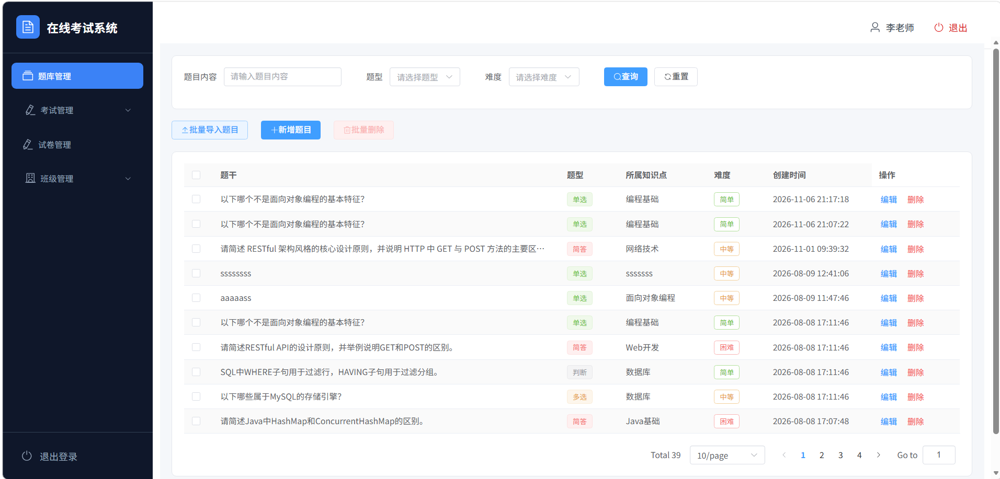
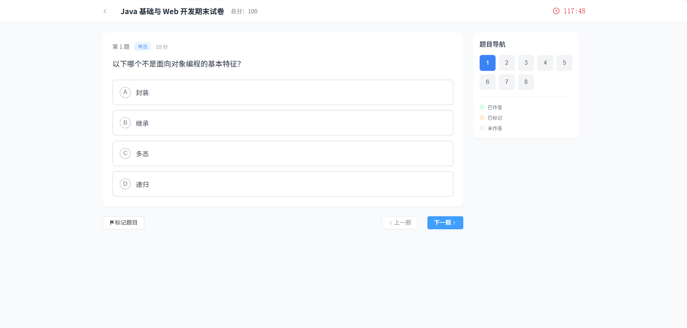
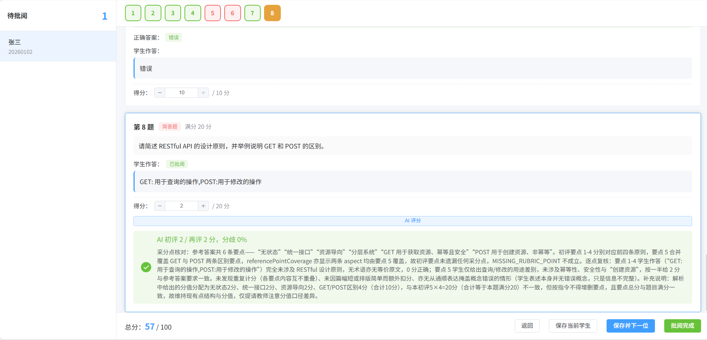
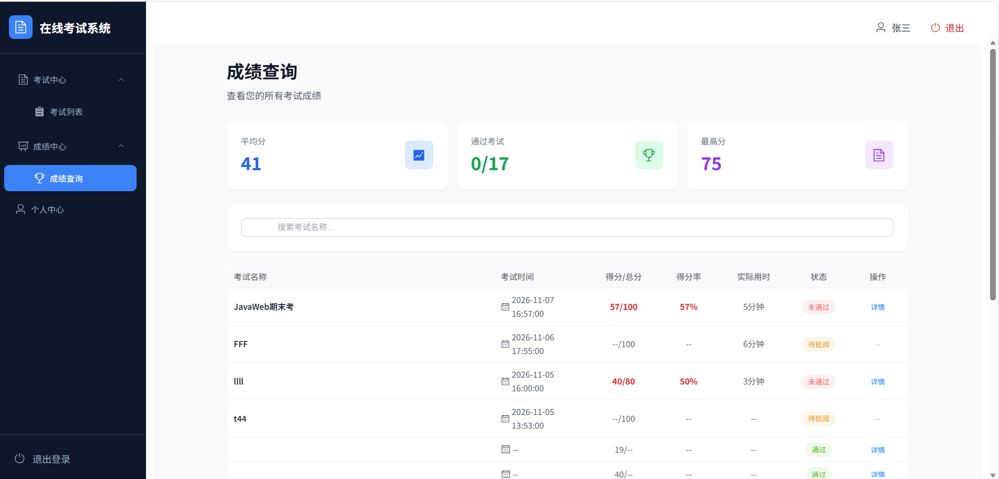
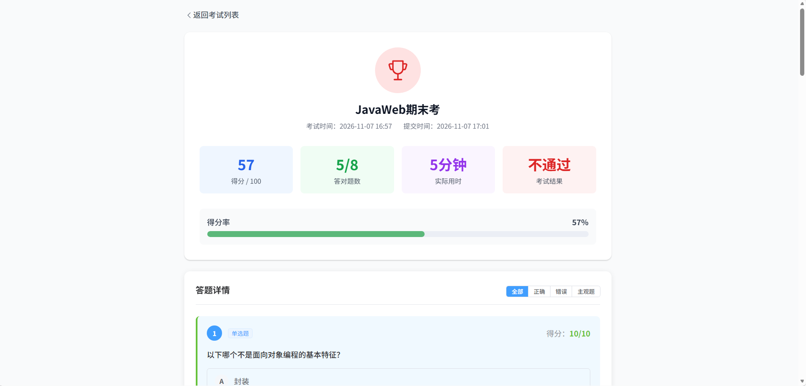

# 在线考试系统（Exam Online System）

> **项目简介：**基于 Spring Boot3 + Spring Cloud Alibaba + LangChain4j + Vue3 的微服务在线考试平台，拆分为用户权限、考试核心、AI 批阅三个服务独立分库，覆盖题库管理、组卷、在线作答与客观题自动批改、主观题 AI 辅助批阅全流程。

[](https://img.shields.io/badge/Java-17-orange)
[](https://img.shields.io/badge/Spring%20Boot-3.2.5-brightgreen)
[](https://img.shields.io/badge/Spring%20Cloud%20Alibaba-2023.0.1.0-blue)
[](https://img.shields.io/badge/Spring%20Cloud-2023.0.1-lightgrey)
[](https://img.shields.io/badge/LangChain4j-1.3.0--beta9-blueviolet)
[](https://img.shields.io/badge/Vue-3.x-42b883)
[](https://img.shields.io/badge/MySQL-8.0-4479a1)
[](https://img.shields.io/badge/license-MIT-blue)

---

## 项目预览

| | | |
| :---: | :---: | :---: |
|  |  |  |
| 登录页 | 题库管理 | 考试答题 |
|  |  |  |
| 主观题批阅 | 成绩详情 | 考试结果 |

> 覆盖三条角色线与完整业务闭环：登录 → 题库管理 → 考试答题 → 主观题批阅 → 成绩详情 / 考试结果。截图位于 `assets/`，命名约定 `preview-{login,questionbank,exam,grading,grade,result}.png`。

## 一、技术栈

| 层 | 技术 |
|----|------|
| 后端 | Spring Boot 3.2.5 · Spring Cloud Alibaba 2023.0.1.0 · Spring Cloud Gateway · Spring Security + JWT（SCA 2023.0.1.0，对应 Spring Cloud 2023.0.1） |
| 数据 | MyBatis-Plus 3.5.16 · MySQL 8.0.31 · Redis 7 · 乐观锁并发控制 |
| 中间件 | Nacos 2.3.2（注册/配置）· Sentinel 1.8.6（限流/熔断）· RocketMQ 5.3.2（异步批阅） |
| AI 能力 | LangChain4j（exam_ai：阅卷辅助）|
| 前端 | Vue 3 · Vite · Element Plus · Axios |
| 文档 | Knife4j（OpenAPI 3） |

---

## 二、仓库结构

单仓库存放全部服务，但每个服务**独立 Maven 工程、独立 jar、独立部署**。

```
exam_online_system/                # 仓库根
├── docker-compose.yml             # 全套编排（中间件 + 数据层 + 应用）
├── .github/workflows/build-push.yml # GitHub Actions：构建并推送应用镜像到 GHCR
├── docker/                        # 各后端服务多阶段 Dockerfile
├── assets/                        # 项目预览截图
├── sql/                           # 建库建表 + 种子数据
│   ├── schema.sql                 # 双库 + 14 张表
│   └── init-data.sql              # 角色/权限/班级/默认账号 种子数据
├── scripts/                       # 一键起全套（等价于 docker compose up）
│   ├── up.sh                      # Linux / macOS
│   └── up.bat                     # Windows
├── exam_cloud/                    # 后端微服务
│   ├── exam_common/               # 共享库（不独立运行）
│   ├── exam_api/                  # 公共 API / Feign 契约（不独立运行）
│   ├── exam_auth_user/            # 认证与权限服务  :8082  库 exam_auth_db
│   ├── exam-core/                 # 业务核心服务    :8081  库 exam_core_db
│   ├── exam_ai/                   # AI 辅助服务     :8083
│   └── exam_gateway/              # API 网关        :8080
└── exam-vue/                      # 前端（Vue3 + Vite + ElementPlus）
```

---

## 三、中间件端口

全部中间件通过 `docker-compose.yml` 编排。注册/配置类组件做了宿主机端口避让（见下文「Windows 端口说明」）。

| 组件 | 容器端口 | 宿主机端口 | 说明 |
|------|---------|-----------|------|
| Nacos | 8848 / 9848 / 9849 | **18848** / 19848 / 19849 | Nacos 2.x gRPC 端口 = HTTP + 1000 |
| Sentinel | 8858 / 8719 | **18858** / 18719 | 控制台 + 客户端心跳 |
| RocketMQ NameServer | 9876 | 9876 | 路由发现 |
| RocketMQ Broker | 10909 / 10911 / 10912 | 10909 / 10911 / 10912 | VIP / 主端口 / HA，同端口映射未做避让 |
| MySQL | 3306 | **13306** | 随 `docker compose up` 一起启动 |
| Redis | 6379 | **16379** | 随 `docker compose up` 一起启动，无密码 |

> MySQL / Redis 用高位端口（`13306` / `16379`）是为了不和你本机已安装的 3306 / 6379 冲突；Nacos / Sentinel 同理避让 Windows 保留段。

> **RocketMQ Broker 对外地址**：`rocketmq/broker.conf` 中 `brokerIP1 = host.docker.internal`，由 compose 的 `rmqbroker.extra_hosts: host.docker.internal:host-gateway` 提供解析。NameServer 只负责返回路由（容器内服务用 `rmqnamesrv:9876`，宿主机本地开发用 `localhost:9876`），客户端拿到路由后直连 `host.docker.internal:10911` 收发消息。Linux 宿主若无法解析 `host.docker.internal`，需在 `/etc/hosts` 补映射或把 `brokerIP1` 改为宿主 LAN IP。

---

## 四、容器化一键部署（推荐）

适合想快速把整套系统（中间件 + 数据库 + 4 个后端服务 + 前端）跑起来的人。无需本机安装 JDK / Maven / Node，只要装好 Docker 与 Docker Compose。

### 4.1 资源要求（先确认再启动，避免 OOM）

全套 11 个容器（Nacos / Sentinel / RocketMQ ×2 / MySQL / Redis / 4 个后端 / 前端）在 **16 GB 宿主 + WSL2 4 GB 上限**下的稳态实测：

| 指标 | 实测值 |
|------|--------|
| 容器内存占用 | **2.65 GB / 3.74 GB**（已用 / Docker 可用上限） |
| 容器 CPU 占用 | 约 10%（4 核可用，启动阶段有短暂峰值） |

请按下面预留资源，否则容器会在启动阶段被 OOM killer 杀掉：

| 项 | 要求 |
|----|------|
| Docker 可用内存 | **≥ 4 GB**（稳态 2.65 GB，需为启动峰留余量） |
| 宿主物理内存 | 建议 **16 GB**；8 GB 机器请先关闭 IDEA、浏览器等内存大户 |
| CPU | 4 核 |

> 内存不足的典型症状：容器退出码 **137**、反复 `Restarting`、Nacos CPU 突然飙到 100%+、接口 503。Nacos 是内存压力下被动 GC、处理服务反复注册注销的受害者，不是元凶。

**WSL2（Windows / Docker Desktop）用户必看**：所有容器共享 `C:\Users\<用户名>\.wslconfig` 里的 `memory` 上限。若该文件写了 `memory=2GB`，必然 OOM，请改为：

```ini
[wsl2]
memory=4GB
processors=4
swap=4GB
```

改完执行 `wsl --shutdown` 并重启 Docker Desktop 才会生效。

> `docker-compose.yml` 已为 Nacos / Sentinel / 4 个 Spring Boot / RocketMQ 设置显式 JVM 堆上限（`JVM_XMX`、`JAVA_TOOL_OPTIONS`、`JAVA_OPT_EXT`），避免 JVM 按虚拟机可见内存把默认堆撑到约 1 GB/进程。这是 4 GB 能跑住的前提，删除这些参数会重新触发 OOM。

### 4.2 拉起全套

```bash
# 克隆后，在项目根执行：
docker compose up -d
```

- 首次会从 GitHub Container Registry（GHCR）拉取 5 个应用镜像（4 后端 + 1 前端），无需本机构建；中间件同样拉取官方镜像。
- 拉取完成后按依赖顺序启动：Nacos / Sentinel / RocketMQ / MySQL / Redis → 后端服务 → 网关 → 前端。
- 浏览器访问 `http://localhost:8080` 即为前端入口；网关对外地址 `http://localhost:18080`（便于直接调 API / 看 Knife4j）。

### 4.3 配置 AI 密钥（可选）

`exam_ai` 的阅卷辅助依赖大模型密钥。不配置也能启动，只是调用批阅时会失败（预期行为）。在项目根创建 `.env`：

```bash
echo "AI_API_KEY=你的SiliconFlow密钥" > .env
```

`docker-compose.yml` 会把宿主 `.env` 的 `AI_API_KEY` 注入到 `exam-ai` 容器（`application-docker.yml` 中 `langchain4j.open-ai.chat-model.api-key: ${AI_API_KEY}`）。

### 4.4 停止 / 清理

```bash
docker compose down            # 停服务（保留 MySQL 数据卷）
docker compose down -v         # 连数据卷一起删（清空所有数据）
```

### 4.5 镜像来源与 CI

- 应用镜像由 **GitHub Actions**（`.github/workflows/build-push.yml`）构建并推送到 **GitHub Container Registry（GHCR，`ghcr.io`）**：无需任何外部密钥——推送使用 Actions 自动注入的 `GITHUB_TOKEN`（工作流已声明 `packages: write` 权限）。每次 push 到 master/main 自动构建并推送 5 个应用镜像。
- 别人 `git clone` 后直接 `docker compose up -d` 即可，**无需本机安装 JDK / Maven / Node，也无需 Docker Hub / 阿里云账号**；镜像前缀通过根目录 `.env` 的 `IMAGE_PREFIX` 指定，默认 `ghcr.io/eny-o`（参考 `.env.example`）。
- 中间件（Nacos / Sentinel / RocketMQ / MySQL / Redis）均使用官方镜像，无需构建。
- 若不想用 CI / GHCR，也可自行本地构建：把 `docker-compose.yml` 中各服务的 `image:` 换回对应的 `build:` 块（参考 `docker/Dockerfile.*` 与 `exam-vue/Dockerfile`），再 `docker compose up -d --build`。此时需本机能拉基础镜像（已配 registry-mirrors）并下载 Maven 依赖。

### 4.6 配置覆盖原理（给想改的人）

每个后端服务都有 `application-docker.yml` + `bootstrap-docker.yml`（激活方式 `SPRING_PROFILES_ACTIVE=docker`）：

- `bootstrap-docker.yml`：把 Nacos / Sentinel 地址从 `127.0.0.1:18848` 改为容器服务名 `nacos:8848` / `sentinel:8858`，并让服务注册 IP 自动探测。
- `application-docker.yml`：把 `localhost:3306` / `localhost:6379` / `localhost:9876` 改为容器服务名 `mysql` / `redis` / `rmqnamesrv`。

配置不走 Nacos 配置中心，仓库内的 docker profile 文件即配置源，因此克隆即可一键启动，无需手动导入配置。

---

## 五、本地开发启动（手动分步）

适合要在本机改代码、单独调试各服务的场景。

### 5.1 环境要求

- JDK 17+
- Maven 3.9+
- Node.js 18+
- Docker + Docker Compose（仅起中间件/数据层时需要）

### 5.2 启动中间件与数据层

```bash
# Windows
scripts\up.bat

# Linux / macOS
bash scripts/up.sh
```

脚本只启动**依赖层**（`nacos` / `sentinel` / `rmqnamesrv` / `rmqbroker` / `mysql` / `redis`），等价于：

```bash
docker compose up -d nacos sentinel rmqnamesrv rmqbroker mysql redis
```

启动后等待依赖就绪（Nacos / MySQL 健康检查 + Sentinel / RocketMQ / Redis 端口探活），最后打印宿主机上后端与前端的启动顺序。本地开发时 `application.yml` 需把数据源 / Redis / Nacos 指向 `127.0.0.1:13306` / `16379` / `18848`（见 5.4）。

> 不带参数的 `docker compose up -d` 会拉起全套：依赖层 + 4 个后端服务 + 前端（即第四章的一键部署）。本地开发请务必用上面的脚本或显式限定服务名，否则宿主机再执行 `mvn spring-boot:run` 会因 8080/8081/8082/8083 被容器占用而端口冲突。

### 5.3 初始化数据

随 `docker compose up` 启动 MySQL 后，**无需手动执行任何 SQL**：

- `schema.sql`：创建双库（`exam_auth_db` / `exam_core_db`）与全部 14 张表；
- `init-data.sql`：写入角色、菜单/按钮权限、一个班级，以及三名默认账号（见 5.6）；
- 数据持久化在 `mysql_data` 卷中，容器重启不会重复初始化。

> 若你本机已自行安装 MySQL / Redis 并希望复用，把各服务的 `application.yml` 中数据源地址改回 `localhost:3306` / `localhost:6379` 即可。

### 5.4 配置后端服务

每个服务都提供了 `application.yml.example`（可入库的样例，**不含敏感信息**）。复制为 `application.yml` 后填值：

```bash
for s in exam_auth_user exam-core exam_ai exam_gateway; do
  cp exam_cloud/$s/src/main/resources/application.yml.example \
     exam_cloud/$s/src/main/resources/application.yml
done
```

需要确认/填写的占位：

| 配置项 | 示例值 | 说明 |
|--------|--------|------|
| MySQL 地址 / 密码 | `127.0.0.1:13306` / `123456` | 与 compose 中 `MYSQL_ROOT_PASSWORD` 一致 |
| Redis 地址 | `127.0.0.1:16379` | 无密码 |
| `exam.internal-api-key` | 自定义字符串 | `exam_auth_user` 与 `exam-core` 两侧**必须相同** |
| `AI_API_KEY`（仅 exam_ai） | 你的模型 Key | 通过环境变量或 `.example` 中的占位填入 |

> `application.yml` 本身被 `.gitignore` 排除，不会入库；请基于 `.example` 在本地生成。

### 5.5 启动服务与前端

**后端（按依赖顺序）：**

```bash
cd exam_cloud/exam_auth_user && mvn spring-boot:run   # :8082 认证与权限
cd exam_cloud/exam-core      && mvn spring-boot:run   # :8081 业务核心
cd exam_cloud/exam_ai        && mvn spring-boot:run   # :8083 AI 辅助
cd exam_cloud/exam_gateway   && mvn spring-boot:run   # :8080 API 网关
```

**前端：**

```bash
cd exam-vue
npm install
npm run dev        # 启动后访问终端输出的本地地址
```

### 5.6 默认账号

所有默认账号密码均为 `123456`（已用 BCrypt 加密写入种子数据）：

| 用户名 | 姓名 | 角色 | 权限范围 |
|--------|------|------|---------|
| `admin` | 系统管理员 | ROLE_ADMIN | 全量（人员 / 权限 / 班级 / 系统管理） |
| `teacher` | 张老师 | ROLE_TEACHER | 题库 / 试卷 / 考试 / 阅卷 / 班级 |
| `student` | 李同学 | ROLE_STUDENT | 考试中心 / 成绩查询 / 个人中心 |

### 5.7 常用访问地址

| 地址 | 说明 |
|------|------|
| `http://localhost:8080` | API 网关入口（前端通过该地址访问后端） |
| `http://localhost:18080/doc.html` 等 | 各服务 Knife4j 接口文档（网关 18080 或各后端端口） |
| `http://127.0.0.1:18848/nacos` | Nacos 控制台（nacos / nacos） |
| `http://127.0.0.1:18858` | Sentinel 控制台 |

---

## 六、Windows 端口说明（排障）

若中间件在 Windows 上偶发「端口被占用 / 连不上」，常见根因是 **TCP 动态端口范围被设得过宽**（如 `1024-65535`），导致 Hyper-V / `winnat` 的排除段吞掉项目端口。永久修复（管理员 PowerShell / CMD）：

```powershell
netsh int ipv4 set dynamicport tcp start=49152 num=16383
netsh int ipv6 set dynamicport tcp start=49152 num=16383
# 执行后重启系统
```

重启后动态范围收敛到 `49152-65535`，项目所用的 `18848` / `18858` / `18719` 等高位端口即永久安全。若仍异常，先执行 `netsh interface ipv4 show excludedportrange protocol=tcp` 查看当前排除段再判断。

---

## 七、说明

本项目为个人学习与作品展示用途，架构决策围绕「渐进式演进」展开，部署与排障细节见上方各章节。

## License

MIT
